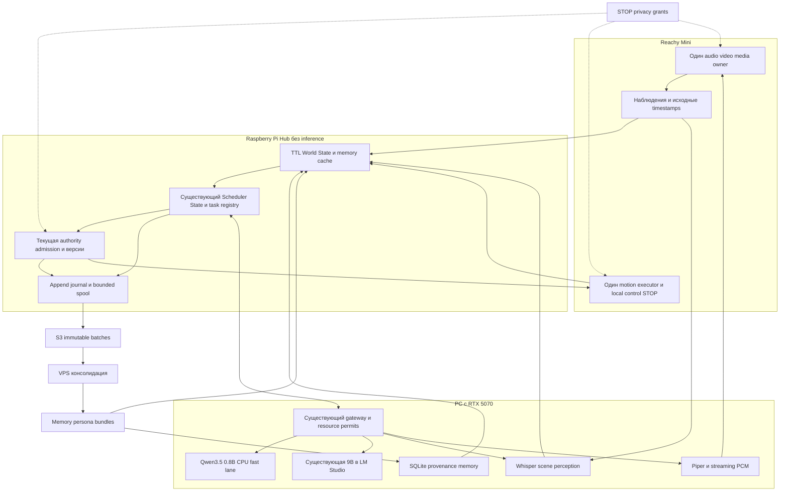
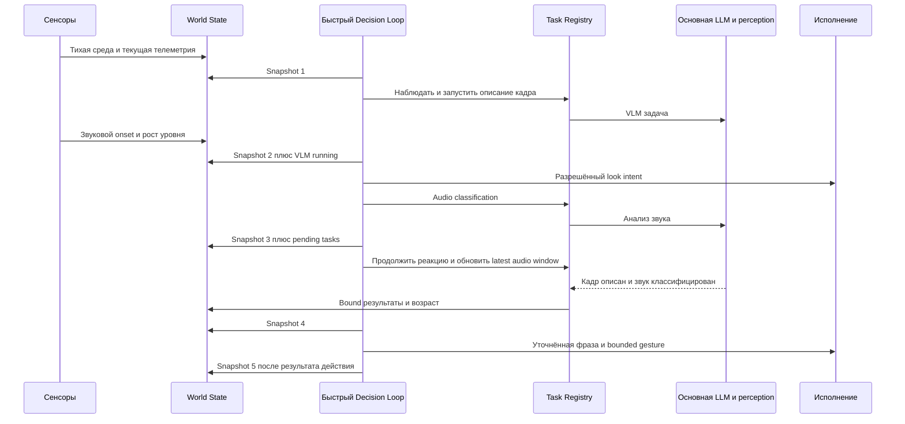
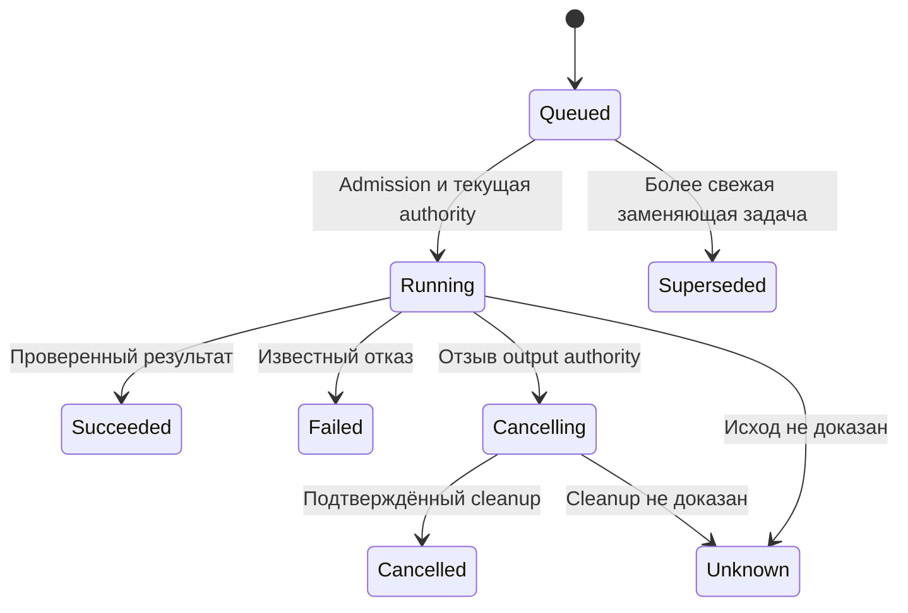
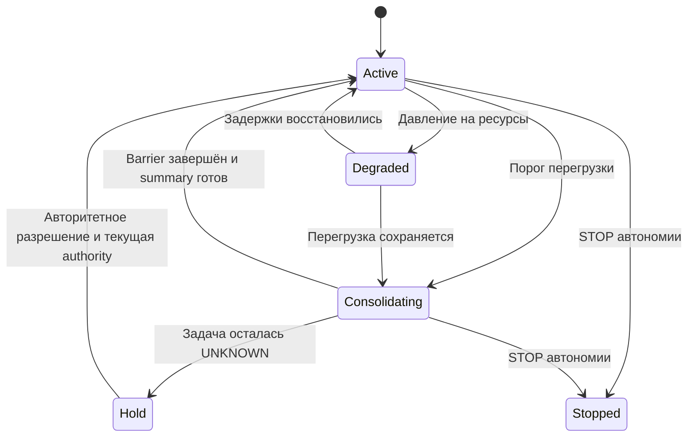
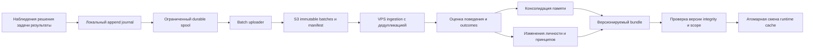

# Автономный Reachy Companion: архитектура и техническое решение

Дата: 17 октября 2026, Europe/Moscow. Версия: 4. Статус: полный целевой дизайн и решение о первом живом выпуске; это документ исследования, не акт приёмки оборудования.

**Рекомендуемый вариант:** довести существующий `reachy_companion.autonomous` до одного постоянно работающего живого цикла. Сохранить Reachy SDK/media и принятый единственный аппаратный executor, отдельный Raspberry Pi Hub без inference и PC с RTX 5070 для моделей. Стартовый профиль: Qwen3.5-0.8B Q8 CPU для решений с периодом 2 секунды, существующая 9B в LM Studio для ответов, существующая связка Whisper → Piper для русского голоса, независимые audio/video adapters. Не переписывать уже имеющиеся scheduler, epochs, память и transport ради замены framework. Конкретную готовность компонентов подтверждают параллельные аудит и baseline, а не этот выбор.

**Запасной вариант:** заменить разговорный/media orchestration слой на официальную Conversation App + локальный Hugging Face speech-to-speech; тот же автономный scheduler подключить адаптером, сохранив один выход в actuators. Это отдельная контролируемая замена, если текущий voice/media путь не проходит конкретную воспроизводимую приёмку. Наличие upstream app само по себе не закрывает автономию.

**Полная цель сохраняется:** непрерывные восприятие и LLM-решения, инициативность, штатные движения, цели, многоуровневая память, развивающаяся личность и принципы, S3/VPS и расширяемые инструменты. Первый живой выпуск и последующие этапы разделены в §17; ранний разговорный тест не подменяет эту цель.

Область проверки: исходный дизайн v3, интерфейсы локального кода и официальные первичные источники, доступные 17 октября 2026. Устройства и сервисы в этой работе не запускались и не изменялись. Ссылки `main` отражают просмотренный подвижный срез, а не frozen deployment pin; API GitHub для получения SHA недоступен через исследовательский инструмент. Перед установкой исполнитель фиксирует точные commits, lockfiles и артефакты в manifest.

## 1 Цели и инварианты

- **Непрерывность решений:** в активном автономном режиме успешное решение, включая `idle`, всегда ведёт к следующей LLM-итерации. Входная реплика для этого не требуется.
- **Непрерывность восприятия:** сенсоры и perception workers обновляют кэш независимо от цикла решений и генерации ответа.
- **Асинхронность:** новая итерация видит частичные результаты, выполняющиеся задачи и изменения среды; ожидание одной задачи не блокирует остальные подсистемы.
- **Инициативность:** робот может самостоятельно посмотреть на источник шума, исследовать помещение, подумать о цели, заговорить или потанцевать под музыку в пределах доступных действий.
- **Ограниченность:** память процесса, контекст, очереди, частота запросов и конкуренция имеют явные бюджеты. Частые итерации не означают неограниченное число одновременных POST.
- **Приоритет управления:** STOP, privacy, отключение автономии и новая authority имеют приоритет над инициативой модели. Safety/control обработчики не ждут очередной LLM-итерации.
- **Честное состояние:** отсутствующий датчик, просроченное наблюдение, незавершённая задача и UNKNOWN обозначаются явно. Модель не получает выдуманный шум для имитации жизни.
- **Расширяемость:** сенсоры, модели и функции подключаются через версионируемые контракты, не меняя ядро цикла.

Always ON — штатный режим постоянной работы: робот включён, слушает, получает кадры и регулярно выбирает допустимые действия, включая штатные движения. Это не ожидание только wake word и не серия конечных smoke runs. Постоянная моторная активность без пауз не требуется; модель может выбрать idle, но не прекращает следующий цикл. Служебные STOP/privacy, отзыв прав и подтверждённая неисправность остаются явными исключениями. Mic OFF запрещает аудиозахват, но сам по себе не равен отключению всех решений по времени, сети или другим разрешённым входам. Полный STOP автономии прекращает новые решения и действия; точные права каждого режима задаются control policy.

## 2 Готовые решения и граница собственной разработки

Принцип: использовать готовые hardware/media/model components и уже написанные интерфейсы проекта. Новая собственная подсистема появляется только для доказанного gap. В этой версии обязательная миграция framework исключена из критического пути первого запуска; это инженерный вывод по объёму уже существующего кода, а не опубликованное сравнение скорости разработки.

### Что действительно есть upstream

| Компонент | Подтверждённая возможность и граница применения |
|---|---|
| Reachy Mini SDK/daemon/media | Общий доступ к камере/аудио и штатному управлению. GStreamer/WebRTC — готовый transport; AEC собственной речи предусмотрен аппаратным media stack. Это не доказательство качества echo suppression в нашей комнате. [Официальный media stack](https://huggingface.co/blog/pollen-robotics/reachy-mini-media-stack) |
| Conversation App | Голос, profiles, tools, motion и MCP Spaces уже реализованы. Не требуется писать второй законченный conversation framework. Произвольный MCP server не следует объявлять поддержанным на основании механизма Spaces. [Официальный README](https://github.com/pollen-robotics/reachy_mini_conversation_app) |
| MovementManager | Готовые очереди и смешивание штатных движений — источник повторного использования; импорт внутреннего модуля требует version pin и integration check. [Исходник](https://github.com/pollen-robotics/reachy_mini_conversation_app/blob/main/src/reachy_mini_conversation_app/moves.py) |
| BackgroundToolManager | Есть async tool tasks; наши deadlines, physical authority и UNKNOWN остаются adapter responsibility. [Исходник](https://github.com/pollen-robotics/reachy_mini_conversation_app/blob/main/src/reachy_mini_conversation_app/tools/background_tool_manager.py) |
| Memory store App | Небольшой JSON store стабильных фактов, а не полная эпизодическая память и evolution. [Исходник](https://github.com/pollen-robotics/reachy_mini_conversation_app/blob/main/src/reachy_mini_conversation_app/memory.py) |
| Hugging Face speech-to-speech | Готовый модульный VAD/STT/LLM/TTS и Realtime transport. Совместимость HTTP API проверяется отдельно от наличия нужного model backend. [Официальный проект](https://github.com/huggingface/speech-to-speech) |

Критический gap подтверждён исходником: `ConversationHandler.send_idle_signal()` запускает локальный idle tool без turn к модели. `say(text)` описан как injected instruction, без гарантии дословного TTS. Поэтому штатный idle не выполняет требование постоянных LLM-решений, а `say()` нельзя без проверки использовать для точной тестовой фразы «Алиса, ...». [Контракт handler](https://github.com/pollen-robotics/reachy_mini_conversation_app/blob/main/src/reachy_mini_conversation_app/conversation_handler.py).

Официальная инструкция подтверждает размещение Conversation App на роботе и локального voice backend на отдельном PC. Это доказывает возможность такой топологии, но не меньшую задержку или меньший объём миграции относительно нашего кода. [Local Reachy guide](https://huggingface.co/blog/local-reachy-mini-conversation).

### Рекомендуемая граница reuse

Сохраняем `Scheduler/State/RemoteGateway`, schema contracts, task permits, context cache, SQLite memory и speech/audio adapters проекта. Локальные исходники перечислены в §19. Их наличие не означает, что full autonomous target уже реализован или принят на железе.

Hardware transport и штатные motion assets повторно используем из Reachy. Целевой стандартный путь — SDK/daemon; если аудит обнаружит уже принятый иной единственный executor, первый выпуск сохраняет его за adapter и документирует отличие. Переход на штатного владельца — самостоятельная передача ownership с остановкой прежнего writer, а не параллельный запуск. Дизайн не разрешает возобновлять UNKNOWN actions.

Новые изменения первого выпуска ограничены связыванием имеющихся компонентов, непрерывным lifecycle, единым актуальным состоянием и измеримой совместной работой audio/video/motion. Непрерывные LLM decisions и реальное участие всех трёх каналов обязательны сразу; advanced tool scheduling, semantic vision и model/TTS overlap имеют свои последующие приёмки. Непрерывный capture не следует заново писать на ALSA, если установленный SDK/media путь проходит приёмку. Равно недопустимо объявить старый camera helper совместимым, пока он останавливает слух.

### Один запасной путь и условие переключения

При воспроизводимом отказе совместного capture/playback/camera либо неподдерживаемом lifecycle текущего runtime координатор выбирает **одну** замену: App на Robot → speech-to-speech на PC → существующая 9B через проверенный совместимый endpoint; Whisper для русского STT; Piper через небольшой protocol adapter внешнего TTS. Autonomous scheduler остаётся единственным semantic dispatcher, а App — единственным front door в media/movement. Автоматические App voice tool effects должны проходить тот же admission; второй независимый цикл ответов не запускается.

Готовый TTS extension point принимает `/v1/audio/speech` и PCM/WAV. Существующий `/stream/say` с NDJSON несовместим с ним напрямую: адаптер выделяет raw PCM, задаёт format/rate, bounded buffering и late-output withdrawal. Отмена HTTP consumer не гарантирует остановку remote synthesis — upstream явно это отмечает. [TTS contract](https://github.com/huggingface/speech-to-speech/blob/main/docs/openai-compatible-tts.md).

Для этого пути требуется проверить App handler hooks, независимый timer, world-state injection, tool mediation и camera without audio quiesce. Если такой adapter не проходит приёмку, запасной путь не объявляется готовым решением и не превращается в новое бесконечное исследование. Pin просмотренных package declarations: App `1.1.0`, Python ≥3.11 и `reachy-mini>=1.11.0`; speech-to-speech `1.0.0`, Python ≥3.10. Это значения текущих исходников, не установленные версии: [App pyproject](https://github.com/pollen-robotics/reachy_mini_conversation_app/blob/main/pyproject.toml), [backend pyproject](https://github.com/huggingface/speech-to-speech/blob/main/pyproject.toml).

Community Physical AI Operating System теперь перенаправляется в `lampOS`. Его README сохраняет Reachy port и daemon, но отдельно исключает optional Pipecat extra из Reachy setup из-за ONNX conflicts. Локальная эквивалентность нашим требованиям не доказана; в выбранный и запасной путь он не входит. Hermes/OpenClaw не требуются для старта. [Первичный источник lampOS](https://github.com/autonomous-ai/lampOS).

### Собственный слой полной цели

TTL World State, непрерывные LLM ticks, bounded admission/authority, goals, provenance memory и S3/VPS evolution остаются проектными расширениями. Расширять существующую реализацию следует по этому контракту; media transport, motion interpolation, базовую библиотеку движений и новый tool protocol создавать заново не требуется.

## 3 Архитектура и размещение



Топология установки различает Raspberry Pi Hub и embedded computer самого Reachy; исходный текст смешивал их. Hub владеет логической оркестрацией и запросами к PC, Robot владеет непосредственным media/motor исполнением и локальным control. Все inference, включая CPU fast, находятся на PC. Сохраняем существующий сетевой путь через Hub; прямой доступ PC к роботу не является условием запуска.

| Подсистема | Размещение и ответственность |
|---|---|
| Sensor/media adapters | Robot: непрерывные reader loops, latest bounded buffers, source identity; без LLM и собственного поведения |
| Perception | PC: STT, scene summary, audio classification; результат содержит исходное наблюдение и неопределённость времени |
| World State и Decision Loop | Hub: согласованный snapshot, compact context, регулярные LLM requests через gateway; без импорта inference libraries |
| Task registry и admission | Hub + PC permits: logical tasks отдельно от фактической занятости backend; deadline не освобождает unresolved permit |
| Physical executors | Robot: одна output audio track, один motor writer, локальная проверка grants/epochs непосредственно перед эффектом |
| Memory | PC SQLite как единственный persistent owner; Hub читает bounded cache, перезапуск сессии не удаляет память |
| Journal/spool | Hub для orchestration events, Robot для нужных local action receipts; asynchronous merge по IDs |
| Learning | VPS: только разрешённые versioned data bundles; прямых команд сервоприводам нет |

На первом выпуске не добавляем Redis/Kafka, отдельную vector DB или новую распределённую control plane. Имеющихся latest caches, SQLite и append journal достаточно для выбранного объёма; это инженерный выбор с последующим пересмотром по измеренным ограничениям. S3/VPS не участвуют в горячем пути решений.

## 4 Все входы автономного цикла

| Вход | Представление | Обновление и срок актуальности |
|---|---|---|
| Последние слова | Final transcript; отдельно provisional text с confidence и revision | По результатам STT; TTL зависит от назначения |
| Звуковая среда | Уровень, дельта уровня, onset, направление при доступном датчике, музыка/шум | Частые измерения; короткий TTL |
| Изображение | Ссылка на frame, scene summary, объекты, изменения, время кадра | Асинхронный VLM; свежесть считается от исходного наблюдения |
| Электроэнергия | Заряд при наличии источника, мощность/ток, тренд, charging state | По адаптеру телеметрии |
| Сервоприводы | Доступные load/current/temperature/position/error показатели | Часто; единицы и физический смысл фиксируются адаптером |
| Дополнительные сенсоры | Например lidar scan summary, расстояния и препятствия | Подключаемый typed adapter с собственной частотой и TTL |
| Сеть | Доступность узлов, RTT, ошибки, возраст последней успешной проверки | Фоновые ограниченные probes |
| Время | Wall clock, monotonic elapsed, время последнего действия/смены цели | На каждой итерации |
| Внутреннее состояние | Режим, очередь, latency, занятые модели, pending actions, ошибки | По task/resource events |
| Предыдущие запросы и решения | Последние turns, короткая сводка, commitments и их исходы | На commit события, с ограничением контекста |
| Постоянная память | Релевантные факты, эпизоды, навыки, предпочтения | Кэш retrieval и фоновая консолидация |
| Личность | Характер, стиль речи, любознательность, социальные привычки | Редкие версионируемые обновления |
| Принципы | Поведенческие нормы, приоритеты, объяснимые правила выбора | Версионируемая политика поведения |
| Закреплённая память | Необязательная текущая цель, подзадачи, причина и timestamp смены | По явному решению сменить цель |

Ток/нагрузка сервопривода не объявляются физическим сопротивлением или моментом без соответствующей калибровки. Если измерение недоступно, значение — `unavailable`, а не вычисленная моделью догадка.

**Конверт наблюдения:** `observation_id`, `source_id`, `source_generation`, `schema_version`, `sequence`, `observed_at`, `received_at`, `expires_at`, `quality`, `value`, `provenance`. На разных узлах сохраняются clock domain и неопределённость времени; недоказанная синхронизация не используется для точных latency claims.

Состояние включает и уровень, и динамику: «шум 42» слабее, чем «уровень вырос, onset дважды, направление неизвестно, последняя речь 12 секунд назад». Даже в тихой комнате меняются время, elapsed, оценки свежести, состояние задач и доступные телеметрические показатели.

## 5 Непрерывный цикл решений

### Планирование итерации

1. По таймеру собрать согласованный snapshot World State, памяти и task registry.
2. Добавить изменения с последнего решения, результаты задач и возраст текущих commitments.
3. Выполнить один быстрый LLM-вызов классификации и следующего шага.
4. Проверить schema, ссылки на наблюдения, limits и authority.
5. Запустить или скорректировать разрешённые асинхронные действия; записать decision event.
6. Назначить следующую итерацию независимо от того, было ли действие.

Входящие события могут ускорить следующий tick и вытесняют устаревший pending snapshot. Они не создают по одному LLM-запросу на каждое измерение. У decision lane максимум один active inference и один latest pending snapshot.

```text
while autonomy_enabled:
    snapshot = latest_world_state + cached_memory + task_status
    decision = await fast_model(compact_context(snapshot))
    validate_and_dispatch(decision, current_authority)
    update_working_state_and_schedule_next_tick()
```

`await` останавливает только этот lane: захват, телеметрия, инструменты, основная генерация, воспроизведение и upload продолжаются. Отключение автономии и overload меняют режим цикла; они не маскируются бесконечными успешными `idle`.

### Частота и вычислительный бюджет

Стартовая конфигурация первого живого выпуска — один запрос раз в 2 секунды (0,5 решения/с) с coalescing без catch-up burst; это проектный параметр, требующий текущего baseline. Диапазон 0,5–2 решения/с остаётся целью настройки по ресурсам, не подтверждённым SLO. В спокойном состоянии допускается меньшая частота, но периодические LLM-вызовы сохраняются. При событиях и незавершённой реакции cadence повышается в пределах бюджета.

Основной inference может продолжаться много быстрых итераций. Для этого fast lane должен иметь реально проверенный запас вычислений и памяти. Если основная модель полностью лишает его исполнения, требование автономного цикла не выполнено: resource scheduler снижает тяжёлую нагрузку или переводит её на другой разрешённый backend. Добавлять запросы в скрытую очередь вместо admission нельзя.

### Выход решения

| Поле | Назначение |
|---|---|
| `decision_id`, `snapshot_version`, `valid_until` | Идентичность и срок применимости |
| `attention_mode` | `idle`, `listen`, `focus`, `think`, `act` |
| `reason_summary`, `evidence_refs` | Краткое обоснование и наблюдения, на которых основан выбор |
| `speech` | Необязательная короткая фраза либо задача полной генерации |
| `motion` | Необязательный bounded gesture/look/dance intent |
| `task_requests` | Запуск фонового reasoning, perception, web/shell/другой функции |
| `task_updates` | Продолжить, отменить, заменить или повысить приоритет существующей задачи |
| `goal_update` | Необязательная аргументированная смена текущей цели |
| `next_tick_hint` | Подсказка cadence; конечный выбор делает scheduler |

Выбранное бездействие содержит причину, условия пересмотра и следующий tick. Отдельный monitor замечает длительную стагнацию и добавляет в следующий контекст вопрос о целесообразности наблюдения/исследования. Он не подделывает внешние события и не принуждает к физическому действию.

`snapshot_version` фиксирует основание решения, но не требует полного равенства мира при dispatch: иначе непрерывная телеметрия отменяла бы каждое решение. Validator перепроверяет относящиеся к действию freshness, authority и существенные предусловия. Продолжение одной реакции использует общий `reaction_id` и уже существующие commitments; очередной tick не повторяет «хмм», motion или tool submission без нового основания.

## 6 Асинхронная реакция в нескольких итерациях



Например, фраза «ой, кто-то упал» допустима только при достаточных наблюдениях; иначе используется неопределённая формулировка. Новый partial звук не обязан ждать предыдущий STT, но backend admission определяет, будет ли он обработан сейчас либо заменит latest pending окно.

Музыка может породить dance intent; меняющиеся шум, сцена и цель влияют на продолжение. Инициативные idle/look/dance выбирает модель с cooldown и bounds. Разрешённый breathing может исполняться готовым motion layer между решениями и вытесняется более приоритетным действием. Постоянно включённые моторы не означают движение без пауз; ожидание не должно быть единственной доступной модели стратегией.

## 7 Реестр задач и адаптация готовых executors

**Задача:** `task_id`, `kind`, `parent_decision_id`, `reaction_id`, `input_refs`, `input_generation`, `goal_version`, `policy_version`, `created_at`, `deadline`, `priority`, `resource_class`, `authority`, `idempotency_key`, `status`, `result_ref`, `cancel_state`.



- Перception обычно использует latest-only coalescing; потеря промежуточного кадра допустима, потеря STOP — нет.
- Один physical resource имеет одного владельца. Speech executor допускает одну активную звуковую дорожку; motion executor арбитрирует совместимые cues и приоритет STOP.
- Side effects имеют отдельное подтверждение результата. Transport timeout не считается доказательством отсутствия действия.
- Старый ответ не меняет новый snapshot: результат проверяется по исходным task/request IDs, generation, TTL и версии цели.
- Устаревшее исследование может пополнить эпизодическую память с правильным timestamp, но не получает автоматически права двигаться или говорить сейчас.
- Функции имеют объявленные входы, resource budget и capabilities: web search, background reasoning, sandboxed shell, чтение данных и дополнительные adapters. Исполнение происходит только в пределах выданных полномочий; расширение scope проходит существующий механизм управления доступом.
- Инструментальный вывод считается данными, а не командой, изменяющей принципы или права runtime.

## 8 Модели и вычислительная платформа

### Конкретный стартовый профиль

| Lane | Выбор и ограничение |
|---|---|
| Fast decision | Существующий Qwen3.5-0.8B Q8, PC CPU-only llama-server, context 4096, object FastChoice, full bounded FastView, один active request; начальный period 2 s |
| Main reasoning | Уже используемая Qwen3.5-9B в LM Studio; точный installed model/instance/tokenizer проверяется аудитом. Не загружать другую 12B ради первого выпуска |
| STT | Существующий Whisper backend с явно выбранным русским языком, один recognizer permit и latest provisional slot |
| Speech | Существующий русский Piper voice, PC CPU → один Robot playback executor; semantic chunks и withdrawal |
| Vision/audio perception | Сначала independent camera stream и реальные измерения; semantic scene и music classification добавляются отдельным PC worker, не выдаются за уже готовые |
| Deep analysis | Поздний optional online backend с явным budget и разрешёнными данными; первый выпуск его не требует |

[Официальная карточка Qwen3.5-0.8B](https://huggingface.co/Qwen/Qwen3.5-0.8B) подтверждает модель; пригодность конкретного GGUF/CPU/runtime определяется проектными испытаниями. Для этого варианта известен проектный Q8 hash `37ae482d336108d23516fa35e8e0c4126688d81018b87178a18d752a1357814f`; он не заменяет свежий audit установленного процесса.

В [pc-live.md](/Users/notanonenough/reachy-companion/docs/autonomous-companion/pc-live.md) Qwen3-0.6B пропускала нужный start/commit. Поэтому прежний абстрактный выбор «около 0.6B» снят. Там же описаны конечные CPU-пробы Qwen3.5-0.8B и hybrid 8/26 GPU layers. Документ позднее выявил недостатки старого audit harness и требует независимый frozen audit: исторические sample timings здесь не переиспользуются как нынешняя сертификация, p95 или гарантия 1 Hz. CPU/2 s выбран как консервативная конфигурация для повторной проверки, а не как доказанный сегодняшний baseline.

Fast на CPU освобождает GPU budget от ещё одной постоянно resident модели, но конкурирует с STT/TTS и threads ОС. Hybrid может быть быстрее, но расходует небольшой свободный VRAM margin; поэтому он следующий оптимизационный шаг только после измерений полного стенда. Увеличивать fast до 2B, main до 12B либо менять OS/LLM server до первого цикла не требуется.

### Совместимость и переносимость

Model transport adapters разделяют native llama.cpp, LM Studio SDK и compatible chat endpoints. URL с похожим `/v1` не доказывает поддержку tools, Responses, cancellation или vision tokenization. При смене serving проверяем exact tokenizer/template, output schema, finish reason, request identity и permits. SDK-specific adapter остаётся локализованным; миграция main позже не меняет World State и action contracts.

Linux/Windows PC различаются runtime/DLL/CUDA и packaging. Запасной speech-to-speech имеет отдельные Windows/non-Windows dependencies; существующий Windows Docker worker не становится drop-in установкой нового backend. [Backend dependency declarations](https://github.com/huggingface/speech-to-speech/blob/main/pyproject.toml).

Для запасного пути сохраняем Piper через endpoint adapter. Qwen3-TTS имеет официально заявленный русский язык, но его checkpoint, VRAM, тембр и wake-word intelligibility на этом стенде ещё не измерены; замена голоса — последующий эксперимент, не обязательный старт. Авторская цифра synthesis latency из model card не является нашей end-to-end задержкой. [Qwen3-TTS card](https://huggingface.co/Qwen/Qwen3-TTS-12Hz-0.6B-CustomVoice).

При потере PC Robot продолжает local control и регистрацию доступных наблюдений, прекращает зависящие от inference действия и явно отмечает degraded state. LLM-решения без доступного backend не имитируются. Перенос fast на Hub/Robot CPU возможен лишь как будущий отдельно измеренный профиль; сейчас это не выбранная схема.

## 9 Контекст без бесконечного роста

Контекст каждой итерации собирается из фиксированных логических блоков:

1. Platform contract и разрешённые действия.
2. Версии личности, принципов и текущей цели.
3. Компактное World State со свежестью и изменениями.
4. Активные commitments и task table.
5. Релевантная память и краткая сводка диалога.
6. Последние несколько решений и наблюдаемые результаты.

Каноническое рабочее состояние обновляется по ключам, а не добавлением одинакового сообщения на каждый tick. Сохраняются `state_version`, `previous_version` и bounded delta; периодически формируется новый полный checkpoint. Детальный timeline остаётся в журнале, а не целиком в prompt.

Если backend не поддерживает замену прошлых сообщений, runtime пересобирает ограниченный prompt/checkpoint. Нельзя считать, что старые KV entries были изменены на месте. Prefix caching применяется только при проверенной поддержке и неизменном содержимом соответствующего prefix.

Итоги фонового reasoning записываются как короткие выводы, evidence и следующие шаги. Для continuity не требуется сохранять скрытую цепочку рассуждений модели. Новые пользовательские слова и старые summaries не должны незаметно менять авторство и уверенность исходных фактов.

## 10 Память личность принципы и изменяемая цель

| Слой | Содержимое | Обновление |
|---|---|---|
| Рабочая память | Текущая сцена, последние слова, reaction state и commitments | На события и итерации, в RAM |
| Контекст разговора | Недавние turns, interrupted replies и summary | По завершению turn и compaction |
| Эпизодическая память | Что наблюдал и делал робот, исходы и timestamps | Локальный журнал → консолидация |
| Семантическая память | Факты о людях/среде, предпочтения, связи, confidence | Фоновая обработка и retrieval |
| Процедурная память | Успешные способы выполнения задач и ограничения | По проверенным исходам |
| Личность | Характер, тон, инициативность, стиль внимания и мышления | Редко, версионируемым bundle |
| Поведенческие принципы | Нормы, приоритеты и правила выбора | Контролируемое развитие с provenance |
| Закреплённая цель | Текущий необязательный замысел и план | По аргументированной смене |

**Запись цели:** `goal_id`, `goal_version`, `text`, `status`, `created_at`, `changed_at`, `last_reviewed_at`, `previous_goal_ref`, `change_reason`, `evidence_refs`, `progress`, `review_after`. Робот вправе сменить или убрать цель, аргументировав решение. Timestamp смены отличается от времени последнего пересмотра: очередной tick не обновляет `changed_at`.

Цель имеет cooldown/hysteresis и критерии прогресса, чтобы не метаться между задачами. Новое существенное событие может оправдать ранний пересмотр. User task и актуальные control ограничения входят в policy приоритетов; собственная цель не расширяет возможности исполнения.

Личность и поведенческие принципы могут развиваться через VPS pipeline в разрешённом диапазоне. Платформенные ограничения STOP/privacy, credentials и capability grants хранятся отдельно и не переписываются learned persona.

Retrieval выполняется асинхронно. Fast loop читает уже доступный memory cache и видит pending retrieval; новая информация применяется на границе следующего snapshot. Конфликтующие факты сохраняют provenance и confidence, а не молча заменяются последней генерацией. Первое persistent storage — уже существующий проектный PC-owned SQLite MemoryStore с provenance и version checks. Не запускаем второй JSON fact store как независимый источник истины. При использовании App его remember/forget становятся adapters к этому owner либо данные мигрируются единожды с mapping IDs и сохранением tombstones. Эпизоды и retrieval расширяют тот же контракт; vector index не является обязательной зависимостью старта.

## 11 Частота фоновых обновлений

Ниже — начальные настройки для настройки по измерениям, а не характеристики уже установленной системы.

| Поток | Политика обновления |
|---|---|
| Аудиоуровень, PCM и аппаратная телеметрия | Часто, по частоте адаптера; агрегация до доступного бюджета |
| STT и аудиоклассификация | Событийно и ограниченные rolling windows |
| Кадры и scene summary | Адаптивно: чаще при изменениях/задаче, реже при статичной сцене |
| Время и task status | Каждый decision snapshot |
| Network health | Редкие bounded probes; ускорение после ошибки |
| Relevant memory cache | При новой теме/цели и периодически |
| Долговременная консолидация | Средняя частота: пакетами событий, например каждые 5–30 минут |
| Личность и поведенческие принципы | Редко: например суточный цикл либо достаточный объём evidence |
| Upload | Постоянный фоновый consumer; batching по времени и размеру |

Источник определяет TTL по смыслу. Последняя картинка может оставаться эпизодом, но перестать быть доказательством текущего положения человека. Input TTL и retention журналов — разные политики.

## 12 Перегрузка и режим консолидации

Для каждой resource class измеряются queue age, deadline slack, service time и p50/p95 latency. Overload определяется конфигурацией порогов: длительное ожидание fast lane, слишком много unresolved задач, рост задержек inference или аппаратная телеметрия нагрузки.



В `Consolidating` робот при доступном разрешённом speech один раз говорит, например: «Я запутался, мне нужно немного времени». Затем прекращает новые поведенческие реакции, речь и инициативные движения; control/STOP и допустимое пассивное наблюдение продолжаются.

Scheduler фиксирует barrier-набор уже начатых задач, отбрасывает заменяемые pending задачи и прекращает новые тяжёлые submissions. Ожидаются terminal/cancelled/known failed исходы barrier, а не бесконечно растущий список. После этого выполняется одна ограниченная консолидация результатов и формируется связный ответ или новое решение.

В barrier входят конечные reasoning/perception/tool attempts. Постоянные sensor loops, uploader и control service в него не включаются: у них нет нормального terminal события в течение сессии.

Ожидание имеет общий предел. UNKNOWN не объявляется «задача закончилась» ради выхода из режима: соответствующий ресурс остаётся в Hold с отдельным recovery. «Перегрелся» используется только при подтверждающей телеметрии; иначе сообщение описывает вычислительную перегрузку или неопределённость.

## 13 S3 VPS и цикл развития



**События:** `event_id`, `robot_id`, `boot_id`, `sequence`, clock metadata, decision/task/observation refs, тип, версия payload и результат. В логах решений хранится краткое обоснование, а не скрытая цепочка reasoning. Метаданные и разрешённые summaries экспортируются постоянно; сырые аудио/видео — отдельный настраиваемый канал с собственной политикой хранения и доступа.

Доставка — at least once: uploader повторяет передачу того же immutable batch с тем же ID/hash, а VPS дедуплицирует по event/batch IDs. Повтор upload не означает повтор physical action. События содержат action outcome и uncertainty, чтобы анализ не обучался на неподтверждённом успехе.

При потере сети журнал буферизуется локально в рамках disk quota. Политика при переполнении заранее разделяет critical decision/action/authority events и вытесняемую высокочастотную телеметрию. Потери отмечаются gap events; upload никогда не блокирует PCM reader, STOP или fast decision loop. Новая неподтверждаемая side-effect работа может ограничиваться при невозможности сохранить обязательный action journal.

VPS выпускает bundle с `bundle_id`, `base_versions`, `new_versions`, schema, evidence refs, change summaries и integrity/authenticity metadata. Runtime проверяет доверенный источник, допустимые поля и expected base version. Старая посылка не заменяет новую; конфликт отправляется на повторную консолидацию. Валидный bundle применяется атомарно между итерациями; незавершённые задачи сохраняют исходную версию policy/goal и проходят повторную проверку перед эффектом.

Обновление памяти, личности и принципов является изменением данных и behavior policy. Автоматическое изменение executable code, credentials и platform safety contract через этот pipeline не предусмотрено. Для расследования и rollback сохраняются предшествующие версии.

## 14 Уже реализованные части и первый живой срез

Это оценка интерфейсов по исходникам и существующим проектным отчётам, а не текущая проверка устройств.

| Компонент в workspace | Что переиспользуем | Что нельзя из этого заключать |
|---|---|---|
| `autonomous/runtime.py`, `state.py`, `contracts.py` | Timer scheduler, FastView/FastChoice, independent jobs, epochs и bounded state | Полная инициативность, goals и continuous physical operation ещё не доказаны |
| `gateway.py` | PC fast/main permits, tokenizer/admission, quarantine | Example config с null endpoints/verified=false не готов к запуску |
| `context.py`, `memory.py` | Async context cache и persistent SQLite provenance memory | Полная episodic/procedural/persona evolution отсутствует |
| `video_adapter.py`, `perception.py` | Latest-only frame processing, реальные pixel metrics | Pixel metrics не дают scene labels; source capture freshness может оставаться unknown |
| `companion_session.py`, audio/speech adapters | Стыковка scheduler с capture, STT, TTS и playback; есть finite/lease lifetime interfaces | Наличие `lease` режима не подтверждает постоянную службу и recovery на железе |
| S1/S2 и worker | Continuous audio reader, bounded provisional STT, final-once, semantic speech chunks | Source/fixtures не заменяют физический streaming overlap и отсутствие self-trigger |
| Motion adapters | Fencing и bounded proposals поверх выбранного executor | Нельзя одновременно запускать native serial owner и daemon writer; антенна17 не равна full head/dance support |

Существующая цепочка Robot capture → Hub → PC STT/9B/Piper → Robot PCM остаётся regression reference. Fast decision branch работает независимо: один LLM tick без речи, затем следующий, пока main/STT/VLM выполняют разрешённую работу. Provisional transcript публикуется как observation с confidence/revision/TTL и не создаёт side effects.

Начальные S1/S2 форматы сохраняются: mono S16_LE/16 kHz, packet TTL до 2 секунд от read receipt; S2 latest windows 0,4–4 s не чаще одного предложения за 0,5 s, один actual STT request. Read receipt не объявляется physical capture time.

Spoken camera helper, который гасит capture на время child, не соответствует одновременному «слушает и смотрит». Есть camera-only исходники и async processing, но в прежнем producer admission требовался mic=false: это конкретный integration gap первого живого выпуска. Его закрывают общим SDK/media path либо отдельной проверенной совместной policy одного владельца, сохраняя STOP и privacy. Простое снятие проверки mic=false без совместной hardware приёмки не является решением.

Первый живой срез обязательно включает реальные микрофон, камеру и хотя бы одно разрешённое штатное движение одновременно с model decisions и голосовым обменом. Семантическое понимание сцены расширяется на следующем этапе; наличие кадров и их обработки нужно доказать уже в первом. Только голосовой ответ через динамик первым автономным выпуском не считается.

## 15 Authority STOP и неизвестные исходы

Порядок приоритетов исполнения: platform control и STOP → privacy и текущие grants → допустимые пользовательские задачи → собственная цель и инициативы. Эти проверки выполняются в executors после LLM и непосредственно перед side effect.

STOP отзывает output authority и очищает pending PCM/cues/actions без ожидания LLM или VPS. Reap и join выполняются вне microphone lock. Capture reader не выполняет HTTP/control callbacks; S2 namespace flock/fsync остаются в отдельном consumer. Архитектура не объявляет обычный SDK API сертифицированным физическим hard stop.

| UNKNOWN domain | Что нельзя автоматически повторять |
|---|---|
| Partial STT request | Новый partial POST для обхода unresolved запроса |
| Model completion | Второй запрос в тот же занятый backend permit |
| Tool side effect | Shell/web write/другая мутация без idempotency либо resolution |
| Robot action | Команда при недоказанном ownership/cleanup |
| Deployment lifecycle | CREATE/START/config mutation поверх canonical pending |

S2 сохраняет intent до POST, с identity/hash/request ID, file/directory fsync и bounded namespace guard. Только own completion либо доказанное отсутствие POST разрешает cleanup; timeout/reload не дают этого права. Полное HTTP framing обязательно; Transfer-Encoding в текущем S2 carrier отклоняется.

Для deployment применяется существующий canonical StrictSlot. UNKNOWN не обходится новым namespace. Описанный в исходном дизайне UNKNOWN CREATE — историческое незакрытое состояние до отдельного доказанного reconciliation; его сегодняшнюю актуальность устанавливает аудит. При сохранении такого UNKNOWN нужен существующий maintenance source contract и явное решение пользователя по готовому impact plan; autonomy design не разрешает restart или slot clear.

Допустимый maintenance проект сохраняет исходную UNKNOWN историю, удерживает managed HOLD, подтверждает прекращение старого Docker execution domain, выполняет fresh reconciliation и лишь затем explicit same-slot supersession. Если final `save(None)` даёт UNKNOWN после возможного replace, durable history и независимый HOLD сохраняются; дальнейшее действие — RO reconciliation, без blind rewrite. Исторический CREATE не становится KNOWN.

## 16 Наблюдаемость и приёмка

| Область | Проверяемый результат |
|---|---|
| Автономия без разговора | В тихой среде продолжаются LLM decision IDs, включая idle; input не требуется |
| Содержательное состояние | В prompt видны свежесть, elapsed, динамика сигналов и реальные изменения |
| Инициативность | Шум/музыка/сцена/цель могут привести к самостоятельно выбранному разрешённому действию |
| Асинхронность | Decision loop продолжает итерации при running main/VLM/STT tasks |
| Ограниченность | При event flood остаются bounded active/pending queues и контекст |
| Память | Факт сохраняется между сессиями, retrieval указывает provenance, конфликты различимы |
| Цель | Смена аргументирована и timestamp меняется только при фактической смене |
| Личность | Bundle меняет разрешённое поведение, воспроизводим по версии и обратим |
| Overload | Одна объясняющая фраза, пауза реакций, конечный barrier и связный выход |
| S3/VPS | Disconnect/retry не теряют critical события и не дублируют их применение |
| STOP и newer authority | Старые результаты не возрождают речь/движения/инструменты |
| Разговор | Continuous capture, содержательный streaming overlap, interruption и свежий следующий turn |
| Живой выпуск | Одновременные audio/video/motion, реальные LLM ticks без речи и короткий голосовой обмен с Алисой, затем постоянный рабочий lifecycle |

Ключевые метрики: decision interval и deadline misses, latency по task class, возраст observations при использовании, queue peaks, idle streak, цель/progress, retrieval hit/conflict, model/VRAM pressure, STOP-to-output-withdrawal, upload lag и dropped telemetry counts. Загрузка GPU 100% не является самостоятельным критерием успеха; важны непрерывность допустимых решений и своевременность реакции.

Точный E2E SLO фиксируется после baseline measurement. Межузловые timestamps не вычитаются без подтверждённого clock basis; read receipt не считается доказанным временем физического захвата или акустического воспроизведения.

## 17 Этапы реализации и конкретный первый выпуск

Новая миграция framework, S3, VPS, развитая личность и дополнительный agent framework не являются воротами раннего живого цикла. Форматы IDs, provenance и versions фиксируем сразу, чтобы последующие этапы дополняли систему, а не меняли смысл истории.

| Этап | Содержание | Условие завершения |
|---|---|---|
| 0 Выбрать принятые owners | Совместить текущие аудит и hardware baseline; frozen code/config/model manifest, один media owner и один motor owner | Известны фактический runtime, допустимые действия, stop/cleanup и остающиеся gaps; не начинать новый общий ресерч |
| 1 Первый живой цикл | Существующий scheduler + CPU fast/2 s + existing 9B/STT/Piper; shared continuous audio/video; bounded stock motion; короткий обмен с Алисой | Все пункты протокола ниже, включая idle LLM ticks и perception во время main. Конечный smoke — только допуск к постоянной службе |
| 1b Постоянная эксплуатация | Тот же принятый путь как service с явным owner lifecycle, наблюдаемостью и controlled recovery | Робот остаётся включённым, слушает, получает кадры, принимает решения и выполняет допустимые движения между тестами; нет необъяснимого обрыва по finite cap |
| 2 Полная инициативность и streaming | Semantic scene/audio/music perception, look/attention, stock head/antenna gestures и dance, task continuation, speech/model overlap и overload barrier | Реальные независимые реакции на сцену/звук при running tasks; движения не ограничены навсегда одним тестовым actuator |
| 3 Память, цели, личность | Episodes/facts/procedural retrieval, persistent goal versions, profiles и контролируемая persona/principles evolution | Continuity между сессиями, provenance/conflicts/forget и обратимость изменений |
| 4 S3/VPS | Durable spool, immutable batches, ingestion/consolidation и bundles | Offline quota/gap policy, дедупликация, base-version check и rollback |
| 5 Расширение и оптимизация | Новые сенсоры/tools, multi-model routing, при необходимости hybrid fast либо иной main; optional paid deep | Каждое расширение сохраняет budgets, authority и измеренную live continuity |

### Конкретные изменения первого выпуска

1. Взять существующие `Scheduler/State/RemoteGateway` и принятый PC model profile. Связать normal companion session с выбранными media/motion owners; не переписывать protocol/runtime целиком. Опубликовать bounded truthful sensor state, elapsed и task statuses в каждый FastView.
2. Закрыть одновременный camera+mic admission и конечные ограничения старых runners. Начать с короткого прогона с проверкой cleanup; затем перевести тот же принятый путь на уже явный lease lifecycle и service supervision. Незавершённые backend/device операции при restart сначала reconcile, новые actions поверх UNKNOWN не запускать.
3. Оставить S1 capture независимым от STT/main/TTS, по одному active request каждого класса и one latest pending frame/window. Проверить, что camera и речь не закрывают микрофон. Начальный motion allowlist — одно штатное малое движение, затем остальные штатные движения по этапу 2.
4. Ввести session report с фактическими owners/versions, counts и gaps. Подтвердить следующий протокол на живом стенде, затем эксплуатационный интервал. Если воспроизводимый voice/media gap требует нового transport framework, выполнить один fit check запасного пути из §2 и принять бинарное решение; не сравнивать новые каталоги.

### Голосовая приёмка с рядом стоящей Яндекс Алисой

Тестовый собеседник — физическая колонка Алиса; человека не привлекаем. Robot использует свой speaker/mic и обычный capture→STT путь. Источник ответа помечается `external_speech`/`speaker_identity=unknown`, если идентичность акустически не доказана. Текст «четыре» сам по себе не удостоверяет, что говорила именно Алиса.

Минимальная последовательность: робот полностью произносит **«Алиса, сколько будет два плюс два?»**, слушает внешний ответ, принимает его через STT, LLM выбирает короткое продолжение, например **«Алиса, сколько будет три плюс два?»**. Каждая фраза к колонке короткая и начинается строго «Алиса, ...». Не используем команды покупок, умного дома, таймеров или бесконечное взаимное пробуждение. Это сценарий физической проверки, не гарантия конкретного ответа колонки и не требование изменить пользовательский режим в обычной эксплуатации.

Тестовые cues проходят дословный text→Piper путь после schema/prefix check. При генерации LLM validator проверяет строку перед TTS; App `say()` не заменяет дословный synthesis. Имеющийся `finite_alice_trial.py` принимает только точный первый arithmetic cue, audio_only и motors disabled: это полезный старый smoke, **не** готовая combined acceptance. Для второго раунда и параллельного движения нужен отдельный normal-session протокол с общими current grants; нельзя снимать ограничения старого gate и называть это тем же тестом.

| Проверка в одной session | Требуемое evidence |
|---|---|
| Тишина до/после обмена | Не менее 10 новых actual LLM decision IDs, включая idle; fixture/replay не считается |
| Голос | Два полных cue playback receipts и свежие внешние audio/STT turns; финальное решение после ответа. Неполное PCM не считать полным вопросом |
| Слух во время речи/вычисления | Продолжаются capture sequence и PCM read receipts; собственный speaker не запускает новый внешний turn |
| Камера | Меняются actual frame IDs и processing receipts во время main/TTS; freshness unknown явно отражена; метрики не выдают scene understanding |
| Движение | Одно разрешённое движение по текущему motor owner и outcome receipt; нет второго writer; control остаётся доступным |
| Асинхронность | Пока main реально running, есть хотя бы два fast completions и независимые sensor updates; при слишком коротком main отдельная ограниченная длительная задача с настоящими receipts |
| Streaming, отдельная приёмка этапа 2 | Целевая проверка: содержательный speech segment реально воспроизводится, пока тот же model response ещё отдаёт deltas; ACK и bytes queued недостаточны. Первый живой цикл допускает озвучивание готового короткого ответа и не объявляется streaming acceptance |
| Отзыв | STOP отзывает дальнейшие PCM/cues без ожидания LLM; late completion не возвращает речь/движение. Пробу выполняет единственный владелец стенда |
| Завершение smoke и service | Подтверждён cleanup smoke; рабочая служба после приёмки остаётся активной по policy. Конечный runner не выдаётся за always-on |

Числа 10 решений и два раунда — предложенные критерии этого выпуска, не существующие результаты. Для service предлагается сначала непрерывный 30-минутный наблюдаемый интервал с теми же owners; это стартовый soak, не доказательство 24/7 надёжности. Прогресс измеряем часами живого принятого цикла и дефектами, а не количеством пройденных новых harnesses. При отказе фиксируем один воспроизводимый blocker и одну следующую исправляемую причину.

## 18 Принятые решения, tradeoffs и открытые параметры

**Принято:** первый живой выпуск на существующем autonomous runtime с Reachy components; один запасной путь App + local speech-to-speech; CPU Qwen3.5-0.8B/2 s как начальный профиль повторной проверки; существующие 9B/Whisper/Piper; independent audio/video; один physical owner; TTL World State и periodic LLM decisions; PC-owned provenance memory; полная последующая S3/VPS и persona/goal функциональность.

| Выбор | Польза | Цена и границы |
|---|---|---|
| Довести текущий runtime | Используем уже реализованные scheduler/epochs/memory/adapters; меньше обязательных замен перед live | Поддерживаем собственную интеграцию; исторические тесты не подтверждают сегодняшнее железо |
| Запасной App/S2S | Готовый voice/media/tool frontend и официальная local topology | Требуются автономный hook, tool mediation и Piper adapter; внутренние API и Windows dependencies могут увеличить миграцию |
| Fast CPU/2 s | Не добавляет fast weights в занятый GPU budget, ясное разделение lanes | Медленнее потенциального hybrid; конкурирует за CPU, p95 надо измерить |
| SQLite + append journal | Мало сервисов, явные provenance/version contracts | Нет готовой масштабной semantic memory; retrieval и retention развиваются позже |
| Hub + PC + Robot | Сохраняет топологию и локальный аппаратный control | Сетевая задержка и несколько owners; all-in-one аппаратный redesign не входит в первый выпуск |

Постоянные решения не требуют постоянной речи: idle сохраняет следующий LLM tick, initiative действует по cooldown и evidence. Развитая память и evolution не блокируют этап 1, но являются обязательными отдельными этапами полной цели.

**Latency:** end-to-end голосовая задержка складывается из endpointing, STT, очередей, scheduling, LLM TTFT/semantic segmentation, TTS, сети и playback buffering. Период fast 2 s может добавить ожидание до следующего tick; при отсутствии backlog это до одного периода, а при busy — больше. Это следствие scheduling, не измеренный p95. Событийное ускорение допускается coalescing в доступный permit, без второго параллельного fast запроса.

У нас нет свежих сопоставимых E2E чисел рекомендуемого и запасного вариантов. Исторические probe values сохранены в их исходных отчётах с caveats; рекламные synthesis timings и GPU utilisation не переносятся в SLO. Baseline измеряет actual first content audio, full question completion, idle decision interval, sensor age bounds, busy gaps и STOP withdrawal. Clock domains и границы метрик фиксируются.

**Стоимость:** первый путь не требует нового платного model API или hardware purchase. Это не «нулевая стоимость»: электричество и обслуживание не измерены. Расход считается как `измеренные kWh × тариф`; S3/VPS — storage GB-month + requests + traffic + оплаченный compute. Провайдер, тарифы, retention и объём пока не выбраны, поэтому суммы и экономию относительно cloud не заявляем. Для fast cadence r решений/с и среднего B tokens/request суточный объём примерно `86400 × r × B`; это формула capacity planning, не API invoice. Online deep по умолчанию отсутствует в первом выпуске.

**Открыто до live rollout:** фактический принятый аппаратный executor; pin code/config/SDK/model; fresh independent runtime audit; совместный audio/video admission; current UNKNOWN reconciliation; доступная телеметрия; measured cadence/latency/thermal/VRAM margins. Это входы аудита и baseline, а не повод снова выбирать десятки frameworks.

**После первого цикла:** semantic vision/music models и их resource admission, полный stock motion set, goal update contract, episodes/retrieval, S3/VPS endpoints/quotas и bundle policy. Основной инвариант не меняется: новое решение строится на реальном текущем состоянии, истории и целях, а результаты асинхронных задач постепенно уточняют поведение.

## 19 Связанные исходники и границы доказательств

- [Исходный пользовательский дизайн v3](/Users/notanonenough/.codex/visualizations/2026/10/10/01a12597-5716-72f1-aa0d-ac8397f384e1/reachy-companion-design-2026-10-17.md) — сохранён без изменений; эта версия является полной переработанной копией.
- [Scheduler и gateway interface](/Users/notanonenough/reachy-companion/src/reachy_companion/autonomous/runtime.py), [World State](/Users/notanonenough/reachy-companion/src/reachy_companion/autonomous/state.py), [контракты](/Users/notanonenough/reachy-companion/src/reachy_companion/autonomous/contracts.py).
- [PC model gateway](/Users/notanonenough/reachy-companion/src/reachy_companion/autonomous/gateway.py), [example config](/Users/notanonenough/reachy-companion/config.autonomous.example.json), [model probes и их последующие audit corrections](/Users/notanonenough/reachy-companion/docs/autonomous-companion/pc-live.md).
- [Persistent memory](/Users/notanonenough/reachy-companion/src/reachy_companion/autonomous/memory.py), [context cache](/Users/notanonenough/reachy-companion/src/reachy_companion/autonomous/context.py), [integration report](/Users/notanonenough/reachy-companion/docs/autonomous-companion/context-live.md).
- [Latest video adapter](/Users/notanonenough/reachy-companion/src/reachy_companion/autonomous/video_adapter.py), [pixel perception](/Users/notanonenough/reachy-companion/src/reachy_companion/autonomous/perception.py), [camera report](/Users/notanonenough/reachy-companion/docs/autonomous-companion/perception-live.md).
- [Normal session lifecycle](/Users/notanonenough/reachy-companion/src/reachy_companion/autonomous/companion_session.py), [speech adapter](/Users/notanonenough/reachy-companion/src/reachy_companion/autonomous/speech_adapter.py), [finite Alice gate](/Users/notanonenough/reachy-companion/src/reachy_companion/finite_alice_trial.py).
- [S1 capture](/Users/notanonenough/reachy-companion/deploy/patches/capture-pump-S1.md), [S2 provisional](/Users/notanonenough/reachy-companion/deploy/patches/provisional-stt-S2.md), [streaming contract](/Users/notanonenough/reachy-companion/deploy/patches/content-token-stream-rollout.md).
- [Краткий журнал решений и первичные источники](/Users/notanonenough/reachy-companion/docs/coordination/design-review-2026-10-17.md).

Исходники подтверждают интерфейсы и ограничения; прежние отчёты — лишь указанный в них scope исторических проверок. Full autonomy, постоянный service, semantic scene understanding, full stock motion, goals/persona evolution и S3/VPS не объявляются уже принятыми. Каждый rollout привязывается к frozen manifest и фактическим runtime receipts. Этот документ не меняет чужие audit/hardware файлы и не выдаёт команды устройствам.
